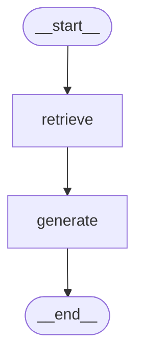

# 검증 결과 (명세 4장)

2026-10-22 셀프 점검. 결과는 **통과 / 실패 / 미확인**으로 적는다. 화면 증명이 필요한 항목은 `docs/screenshots/`의 캡처로 증명하며, 캡처 전에는 미확인으로 둔다.

- 자동 확인 재현: `python -m scripts.verify` (아래 ✅ 자동 표시 항목 20개, 2026-10-22 실행 20/20 통과)
- 설정을 바꾸는 실험(청크 크기, Top-k)과 키 없음·색인 없음 상태는 스크립트 안에서만 흉내 내고 `config.toml`, `chroma_db`는 바꾸지 않는다.
- 모델 `gpt-5.4-mini`, 검색 `mmr`, 청크 1000/200, Top-k 8

## 4.1 데이터와 색인 (F2001~F2002)

| 확인 항목 | 결과 | 증거 |
|---|---|---|
| 로드한 항목 수와 색인된 청크 수가 같다 | 통과 ✅ | 항목 204, 청크 204 |
| 색인을 두 번 실행해도 청크 수가 늘지 않는다 | 통과 ✅ | 204 → 204 (청크 ID = 항목 id라 덮어쓰기) |
| 항목 1건의 색인 텍스트에 의도한 속성이 모두 있다 | 통과 ✅ | `이름: Spring for Apache Kafka / id: kafka / 분류: Messaging / 설명: Publish, subscribe, store, and process streams of records.` |

## 4.2 문서 수집과 색인 (F2003~F2005)

예시: Kafka · 4.1.x · "Kafka 리스너의 동시 실행 수(concurrency)는 어떻게 설정하나?" (첫 실행)

| 확인 항목 | 결과 | 증거 |
|---|---|---|
| 프롬프트1이 뽑은 검색어 목록 | 통과 ✅ | `spring for apache kafka`, `concurrency`, `concurrent message listener`, `container factory`, `kafka listener`, `spring.kafka.listener` |
| 프롬프트2에 따라 색인된 문서와 버려진 문서 구분 | 통과 ✅ | 후보 3: `messaging/kafka`, `messaging/pulsar`, `data/sql` → 색인 `messaging/kafka`(청크 11), 버려짐 `messaging/pulsar`, `data/sql` |
| 같은 질문을 다시 해도 수집하지 않는다 | 통과 ✅ | 두 번째: 새 검색어 0, 새 청크 0, 0.0초 (`data/collect_log.json` 캐시) |
| 항목 자체 문서가 빠지지 않는다 | 통과 ✅ | Initializr `doc_url`이 가리키는 `reference/pages/messaging/kafka.adoc`이 이 (항목, 버전)으로 색인됨 |
| 청크 크기·중복을 바꾸면 청크 수가 달라진다 | 통과 ✅ | 같은 문서 1000/200 → 11개, 500/100 → 27개 |

## 4.3 답변과 근거 (F2006~F2008)

| 확인 항목 | 결과 | 증거 |
|---|---|---|
| Top-k를 바꾸면 근거 목록이 달라진다 | 통과 ✅ | top_k 4 → 근거 4개, 8 → 8개 (항목 정보 1 + 문서) |
| LangGraph가 retrieve·generate 두 노드다 | 통과 ✅ | 아래 그래프 구조 출력 |
| 답변 본문의 근거 번호와 화면의 근거 목록이 일치한다 | 미확인 | 캡처 ① 필요. 로직: `web/app.js` `citedSources` (본문의 `[근거 N]`만 목록에 표시) |
| 근거 목록에 항목 메타데이터와 외부 문서가 구분 표시된다 | 미확인 | 캡처 ① 필요. 출처 유형: `Initializr 항목 정보`, `Initializr 의존성 좌표`, `Spring Boot {버전} 문서`, `springdoc-openapi {판} 문서` |
| 문서에 없는 것을 물으면 확인되지 않는다고 답한다 | 통과 ✅ | "Kafka 브로커에 권장되는 JVM 힙 메모리 크기는?" → "문서에서 확인되지 않는다" (rag-comparison.md 6번도 같음) |
| 인용된 근거가 없으면 화면에 안내된다 | 미확인 | 캡처 ② 필요. 로직: `renderSources` → "ⓘ 답변에 인용된 근거가 없습니다." |

## 4.4 서비스 기능과 화면 (F2009~F2012)

| 확인 항목 | 결과 | 증거 |
|---|---|---|
| 항목을 바꿨을 때 이전 대화가 섞이지 않는다 | 미확인 | 캡처 ③ 필요. 대화는 localStorage `chat:{항목}\|{버전}`에 따로 저장 |
| 조건 탐색 결과에 조건과 맞지 않는 항목이 섞이지 않는다 | 통과 ✅ | "메시징 큐에 쓸 수 있는 의존성" → rabbitmq, kafka, pulsar, activemq, artemis, solace, cloud-stream 등 모두 Messaging 분류. 무관한 조건("냉장고 온도를 조절하는 의존성") → 빈 결과. 캡처 ④ |
| 도메인 특화 기능 결과에도 근거가 제시된다 | 통과 ✅ | Kafka 4.0.x 가이드에 `[근거 N]`, 출처 Initializr 의존성 좌표 + 항목 정보 + Spring Boot 4.0.x 문서. 캡처 ⑤ |
| 문서 수집과 답변 생성 중 진행 상태가 표시된다 | 통과 ✅ (화면 미확인) | `/api/ask` SSE step 전달 확인 (uvicorn 실측 0.5→1.8→2.9초에 하나씩). 화면 캡처 ⑥ 필요 |
| 색인이 없는 상태와 API 키가 없는 상태에서 안내가 표시된다 | 통과 ✅ (화면 미확인) | `/api/status`가 키 없음 `gms_key: false`, 색인 없음 `items_total: 0`을 돌려주고 화면이 배너로 안내. 캡처 ⑦ 필요 |
| 위험 도메인이면 전문가 조언 대체 아님 안내 | 해당 없음 | 기술 문서 도메인 (requirements.md 2절 결정) |

## 4.5 심화 기능 (F2013~F2016)

| 확인 항목 | 결과 | 증거 |
|---|---|---|
| F2013 화면이 HTML·CSS·JS로 동작하고 질문·답변·근거가 모두 표시된다 | 미확인 | `server.py`(FastAPI) + `web/`. 캡처 ① 필요 |
| F2014 유사도 검색과 MMR의 근거 목록 차이 | 통과 | rag-design.md 6.1 (5개 질문 비교, `python -m scripts.compare_search`) |
| F2015 대표 질문의 RAG 사용 전후 답변을 나란히 확보 | 통과 | rag-comparison.md (6개 질문, 답변 전문 포함) |
| F2016 근거 목록에 출처 종류가 구분 표시된다 | 미확인 | springdoc 질문의 근거에 `springdoc-openapi 3.x 문서` 표시. 캡처 ① (springdoc 질문) 필요 |

## 4.6 RAG 사용 전후 품질 비교

| 확인 항목 | 결과 | 증거 |
|---|---|---|
| 대표 질문 5개 이상, 근거 없이 틀리기 쉬운 질문 | 통과 | 6개. 4.0에서 바뀐 값, 사라진 기능, 문서에 없는 수치 포함 |
| RAG 없이 한 번, 근거를 붙여 한 번 답하고 나란히 기록 | 통과 | rag-comparison.md 3절 답변 전문 |
| 사실 정확성·근거 제시·모름 응답 세 기준 비교 | 통과 | 정확성 2/5 → 5/5, 근거 0/5 → 5/5, 모름 0/2 → 2/2 |
| 비교 결과 문서를 제출물에 포함 | 통과 | `docs/rag-comparison.md` |

## 4.7 비기능 요구사항 (NF2001~NF2007)

| 확인 항목 | 결과 | 증거 |
|---|---|---|
| NF2001 대표 질문의 처리 시간 | 통과 ✅ | 이미 색인된 질문 2~3초, 처음 수집하는 질문 수집 3.5초 + 답변 약 3초 (uvicorn 실측 6.0초) |
| NF2002 이미 수집한 검색어를 다시 수집하지 않는다 | 통과 ✅ | 4.2 세 번째 항목 |
| NF2003 소스와 제출물에 API 키가 없다 | 통과 ✅ | `load_dotenv()`로 불러온 키 값으로 git 전체 이력(`git log -p --all`)과 추적 파일 검색 0건, `.env`는 gitignore |
| NF2004 화면에 API 키·프롬프트 전문·오류 추적이 노출되지 않는다 | 통과 ✅ | 내부 오류를 일부러 내면 `/api/ask`는 `error` 이벤트로 짧은 안내만, `/api/explore`는 502 + 짧은 안내. 추적은 서버 콘솔에만. 화면에는 프롬프트를 보내지 않는다 |
| NF2005 수집·색인·검색·생성·UI 모듈 분리 | 통과 | `data_prep/`(수집) · `vector_store/`(청킹·색인) · `rag/`(검색·생성) · `services/`(특화) · `server.py`+`web/`(UI). 의존 방향 CLAUDE.md |
| NF2006 외부 호출 재시도·간격·식별 정보 | 통과 | `data_prep/boot_docs.py` `http_get`: 1.1초 간격, 3회 재시도(5xx·네트워크), GitHub 한도 초과 안내, User-Agent `ssafy-rag-project/0.1 (student project)`. Initializr 호출도 같은 User-Agent, 연속 호출 사이 1.1초 |
| NF2007 데이터와 문서의 출처·이용 조건 기록 | 통과 | requirements.md 1.1 (start.spring.io, spring-boot, springdoc, GitHub API, docs.spring.io) |

## 4.8 제출 전 점검

| 확인 항목 | 결과 | 비고 |
|---|---|---|
| 필수 기능 F2001~F2012가 모두 동작한다 | 통과 (화면 일부 미확인) | 4.1~4.4. 화면 캡처 ①~⑦ 남음 |
| 선택한 심화 기능이 동작하고 필수 기능 결과와 비교되어 있다 | 통과 | F2013(화면 캡처 남음), F2014(6.1), F2015(rag-comparison.md), F2016(springdoc) |
| 증명용 스크린샷을 모두 첨부했다 | 미확인 | 아래 캡처 목록 |
| 요구사항 정의서·설계문서·소스코드·README.md 포함 | 통과 | `docs/requirements.md`, `docs/rag-design.md`, 소스, `README.md` |
| 검증 결과(요구사항 대조표, 테스트 결과표, 셀프·상호 체크리스트) 포함 | 일부 | 이 문서(대조표·결과표·셀프 체크). 상호 점검은 옆 교육생이 같은 체크리스트로 진행 |

## 캡처 목록 (`docs/screenshots/`)

| 번호 | 파일 | 내용 | 관련 항목 |
|---|---|---|---|
| ① | `01-answer-sources.png` | 질문 → 답변 → 펼친 근거 목록 (Initializr 근거와 문서 근거가 함께). springdoc 질문이면 F2016도 증명 | 4.3, F2013, F2016 |
| ② | `02-no-citation.png` | 인용된 근거가 없을 때 "답변에 인용된 근거가 없습니다" | 4.3 |
| ③ | `03-chat-separation.png` | 항목(또는 버전)을 바꾸면 대화가 따로 보임 | 4.4, F2009 |
| ④ | `04-explore-cards.png` | 조건 탐색 카드 | 4.4, F2011 |
| ⑤ | `05-guide.png` | 버전 맞춤 사용 가이드와 근거 | 4.4, F2010 |
| ⑥ | `06-progress.png` | 수집 중 진행 상태 박스 | 4.4, F2012 |
| ⑦ | `07-no-key.png` | 키가 없을 때 안내 배너 (`.env` 이름을 잠시 바꾸고 서버 재시작) | 4.4, F2012 |

## 요구사항 대조표

| 요구사항 | 구현 위치 | 검증 |
|---|---|---|
| F2001 항목 메타데이터 적재 | `data_prep/initializr.py` | 4.1 |
| F2002 메타데이터 색인 | `scripts/build_items.py`, `vector_store/store.py` | 4.1 |
| F2003 검색어 추출 (프롬프트1) | `rag/prompts.py` `SEARCH_TERMS`, `rag/collect.py` | 4.2 |
| F2004 외부 문서 수집 (프롬프트2) | `data_prep/boot_docs.py`, `data_prep/external_docs.py`, `rag/collect.py` | 4.2 |
| F2005 외부 문서 색인 | `vector_store/chunking.py`, `rag/collect.py` | 4.2 |
| F2006 근거 검색·병합 | `rag/graph.py` `retrieve` | 4.3 |
| F2007 LangGraph 답변 생성 | `rag/graph.py` `generate`, 프롬프트3 `ANSWER` | 4.3 |
| F2008 근거 표시 | `web/app.js` `citedSources`, `renderSources` | 4.3 (캡처 ①②) |
| F2009 항목·버전 선택, 대화 분리 | `web/` | 4.4 (캡처 ③) |
| F2010 버전 맞춤 사용 가이드 | `services/guide.py`, `data_prep/initializr.py` `fetch_coordinates` | 4.4 (캡처 ⑤) |
| F2011 조건 기반 항목 탐색 | `services/explore.py`, `/api/explore` | 4.4 (캡처 ④) |
| F2012 진행 상태·안내 | `server.py` SSE, `no_docs_notice`, `web/` 배너 | 4.4 (캡처 ⑥⑦) |
| F2013 프론트엔드 직접 구현 | `server.py`, `web/` | 4.5 |
| F2014 MMR | `config.toml` `search.mode`, `scripts/compare_search.py` | 4.5, rag-design.md 6.1 |
| F2015 RAG 전후 비교 | `scripts/compare_rag.py`, `docs/rag-comparison.md` | 4.6 |
| F2016 여러 문서 출처 결합 | `data_prep/external_docs.py` (springdoc) | 4.5 |
| NF2001~NF2007 | 4.7 표 | 4.7 |
